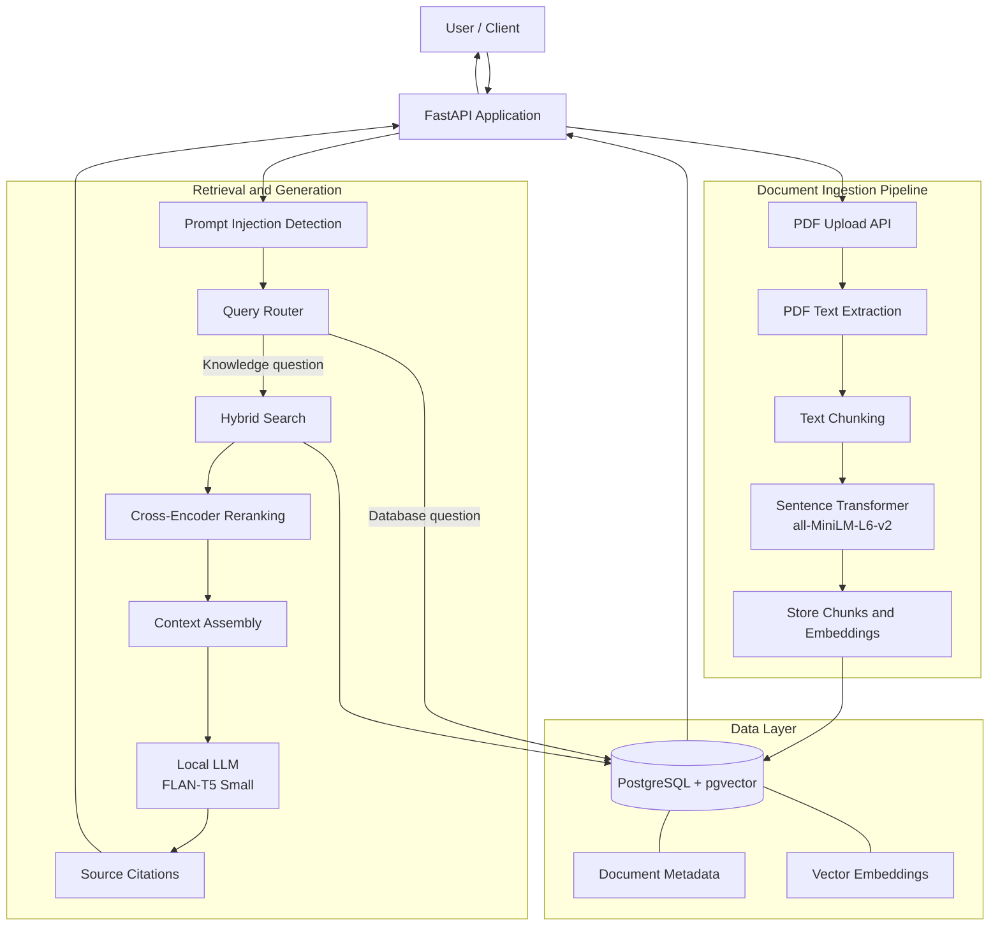

# Enterprise AI RAG Platform - Architecture

## 1. Overview

The Enterprise AI RAG Platform is a Python-based application that combines document ingestion, semantic retrieval, reranking, and local language model generation. It uses FastAPI to expose API endpoints and PostgreSQL with pgvector to store document information and vector embeddings.

This document describes the project's high-level architecture, data flows, API endpoints, and major technology choices.

## 2. System Architecture

The diagram represents the documented high-level flow. Exact implementation details should be verified against the current source code.

## 3. Request Flow

1. A client submits a question to the FastAPI application.
2. The application applies prompt injection detection.
3. The query router selects the appropriate processing path.
4. Knowledge questions use hybrid retrieval against the document data store.
5. Retrieved results are reranked using a Cross-Encoder.
6. Relevant text is assembled into context for generation.
7. The local language model generates a response based on the supplied context.
8. The API returns the response with source citations where applicable.
9. Database questions follow the database processing path supported by the application.

## 4. Document Ingestion Flow

1. A user uploads a PDF using `POST /documents/upload`.
2. The application extracts text from the uploaded document.
3. The extracted text is divided into smaller chunks.
4. The embedding model converts the chunks into vector representations.
5. The application stores document information, chunks, embeddings, and associated metadata in PostgreSQL with pgvector.
6. The stored information becomes available to the retrieval workflow, subject to the implemented ingestion and indexing behavior.

## 5. Retrieval and Generation

### Query routing

The query router directs supported questions to the appropriate processing path, including knowledge retrieval and database-related processing.

### Hybrid retrieval

The retrieval pipeline uses hybrid search to identify relevant document content. PostgreSQL and pgvector provide the underlying data and vector-search capabilities.

### Reranking

A Cross-Encoder reranks retrieved results to help prioritize the content most relevant to the user's question.

### Context assembly and generation

Relevant text is assembled into context and passed to the configured local language model, `google/flan-t5-small`.

### Source citations

The application can return source citations where applicable, helping users relate generated answers to retrieved documents.

## 6. Data Layer

PostgreSQL with pgvector serves as the main persistence layer for document-related information and vector embeddings.

The data layer supports:

- Document information and metadata
- Stored text chunks
- Vector embeddings
- Retrieval for knowledge questions
- Database access for supported database-related questions

The exact schema and indexes are defined by the database implementation and migrations or setup scripts present in the repository.

## 7. Technology Stack

| Component | Technology |
|---|---|
| Programming language | Python |
| API framework | FastAPI |
| Relational database | PostgreSQL |
| Vector search | pgvector |
| Embedding model | `all-MiniLM-L6-v2` |
| Reranking | Cross-Encoder |
| Local language model | `google/flan-t5-small` |
| Database access | SQLAlchemy and Psycopg |
| Containerization | Docker |
| Testing | pytest |

## 8. API Endpoints

| Method | Endpoint | Purpose |
|---|---|---|
| GET | `/` | API welcome response |
| GET | `/health` | Health check |
| POST | `/ask` | Ask a question |
| POST | `/documents/upload` | Upload a document |

Interactive API documentation is available at `/docs` when the API is running locally.

## 9. Security Considerations

The project includes prompt injection detection as one layer of protection. Retrieved documents and uploaded content should be treated as untrusted input.

Before production deployment, consider adding or verifying:

- Authentication and authorization
- Document-level access control
- File type and file size validation
- Database credential management
- Request rate limiting
- Structured logging and monitoring
- Security testing for retrieval and generation workflows

These are production considerations, not claims that every control is already implemented.

## 10. Evaluation and Testing

The project includes automated tests and an evaluation script to assess configured application behavior.

The current development evaluation set previously passed 6 of 6 configured cases. This is a small evaluation set and should not be interpreted as a guarantee of production accuracy, robustness, or performance.

Further evaluation should measure retrieval relevance, answer quality, citation correctness, unsupported-answer behavior, latency, and security handling across a larger set of representative questions.

## 11. Deployment Notes

The current Docker Compose configuration starts the API service. PostgreSQL runs separately and must be configured and accessible to the API.

For local development:

- Configure `DATABASE_URL` in the local `.env` file.
- Keep `.env` and actual credentials out of version control.
- Ensure PostgreSQL with pgvector is running before using database-backed endpoints.
- Verify the API health endpoint after starting the service.

## 12. Known Limitations

- The evaluation dataset is small.
- Retrieval quality depends on document parsing, chunking, embeddings, and query formulation.
- Local language model performance depends on available hardware.
- Production use requires further security, monitoring, scaling, and reliability work.
- The architecture diagram is a high-level representation; verify detailed routing and data operations against the implementation.

## 13. Potential Future Improvements

- Expand the evaluation dataset and retrieval metrics.
- Improve document parsing and chunking strategies.
- Add authentication and role-based access control.
- Add distributed tracing and performance monitoring.
- Introduce continuous integration and automated deployment.
- Evaluate alternative embedding and reranking models.
- Improve document lifecycle management and ingestion observability.

---

**Project:** Enterprise AI RAG Platform

**Repository:** [poojapandit1109-boop/enterprise-ai-rag-platform](https://github.com/poojapandit1109-boop/enterprise-ai-rag-platform)